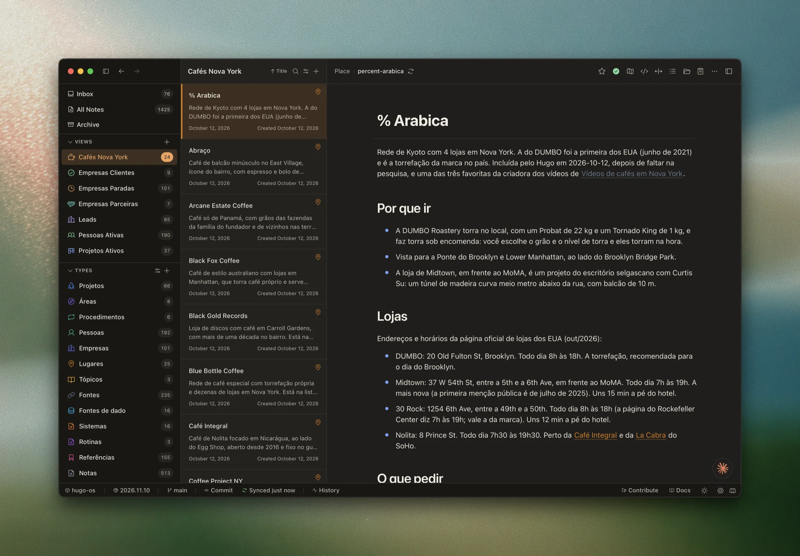
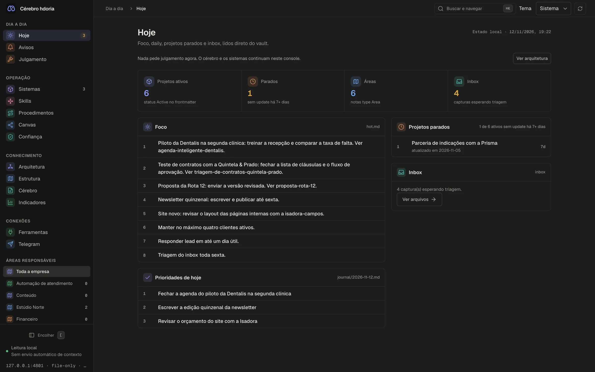
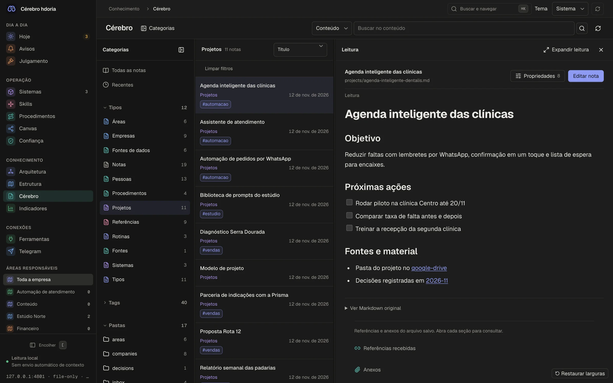
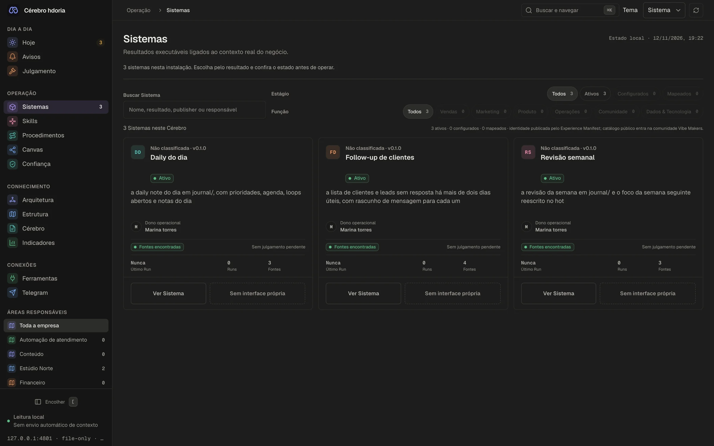
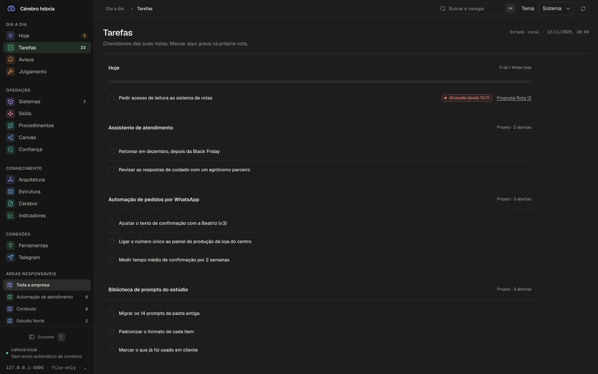
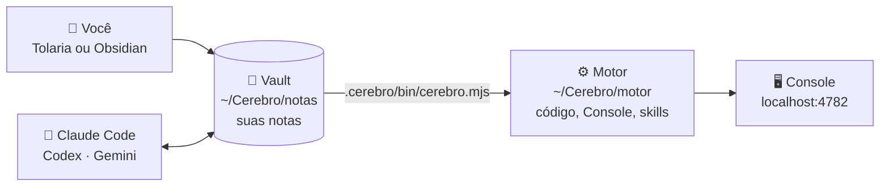

<div align="center">


<br/>

<a href="#-instalar"></a>
<a href="CHANGELOG.md"></a>
<a href="LICENSE"></a>
<a href="https://tolaria.md"></a>
<a href="https://obsidian.md"></a>


<br/><br/>

**Segundo Cérebro** é uma pasta de notas que o seu agente de IA lê e mantém em dia.<br/>
Você abre no Tolaria ou no Obsidian. O Claude Code (ou o Codex) trabalha dentro dela com as skills que vêm junto.<br/>
E um Console no navegador mostra o que rodou e o que espera a sua aprovação.

</div>

<br/>

## 😮‍💨 O problema

Todo dia eu abria uma conversa nova com a IA e começava do zero. Quem é o cliente, o que a gente decidiu semana passada, qual era o número, quem ficou de mandar o quê.

- **O contexto mora espalhado.** Um pouco no e-mail, um pouco no WhatsApp, um pouco na transcrição da call, um pouco na cabeça.
- **A IA esquece tudo.** Cada sessão nova é um estagiário no primeiro dia.
- **Decisão some.** Duas semanas depois ninguém lembra por que escolheu aquilo, nem quem estava na call.
- **Automação sem rastro dá medo.** Rodou? Quem aprovou?

## 🔁 Com o Segundo Cérebro

| Sem | Com o Segundo Cérebro |
|---|---|
| Explicar o negócio de novo a cada conversa | O agente lê o mapa do negócio, os projetos quentes e as pessoas antes de responder |
| Transcrição de call esquecida numa pasta | `/call` vira a call em decisões, ações, dores e números, com a fonte citada |
| Nota que envelhece sem ninguém ver | `/revisar` acha o que ficou velho ou conflitante, e você confirma ou marca como superada |
| O dia acaba e o que aconteceu some | `/daily` fecha o dia em 5 a 10 minutos e guarda até 5 fatos em notas curtas |
| Rotina rodando sem você saber | Cada execução deixa recibo, e o que precisa de julgamento espera você no Console |
| Conteúdo preso numa ferramenta | Markdown numa pasta sua, versionável no Git |

<br/>

## 🖼️ Como fica

<div align="center">

<br/>
<sub><b>No Tolaria</b>: o meu próprio vault, o hugo-os, com os tipos, as vistas na lateral e uma nota de lugar aberta (sim, eu guardo cafés de Nova York no segundo cérebro).</sub>
<br/><br/>


<br/>
<sub><b>Hoje</b>: o foco, as prioridades da daily, o projeto parado e a caixa de entrada. <b>Cérebro</b>: as notas por tipo, com leitura formatada e edição só quando você pede.</sub>
<br/><br/>

<br/>
<sub><b>Sistemas</b>: o que roda, quem é o dono, quantas fontes usa e quando rodou pela última vez.</sub>
<br/><br/>

<br/>
<sub><b>Tarefas</b>: os checkboxes das notas, com o que vence hoje no topo. Marcar aqui grava na própria nota.</sub>
<br/><br/>
<sub>Os prints do Console usam um vault de demonstração: a empresa, as pessoas e os números são inventados.</sub>
</div>

<br/>

## 💬 Como é conversar com ele

A diferença aparece na conversa. Você não cola contexto, não explica quem é quem. O agente abre as notas, responde e mostra de onde tirou.

<details open>
<summary><b>🟠 Claude Code: uma pergunta qualquer</b></summary>

<br/>

```text
você   o que eu combinei com a Beatriz sobre os pedidos por WhatsApp?

claude Na call de 05/11 vocês fecharam duas coisas:
       1. Toda mensagem automática passa pela Beatriz antes de ir pro cliente.
       2. O piloto começa só na loja do Centro.
       > "eu quero ver cada mensagem antes de sair, pelo menos no primeiro mês"
         [[2026-11-05]]
       Ficou aberto: quem cuida dos pedidos fora do horário. Quer que eu
       guarde isso como pendência no projeto?
```

</details>

<details>
<summary><b>🟠 Claude Code: tratar uma call</b></summary>

<br/>

```text
você   /call  (e cola a transcrição da reunião com a clínica)

claude Li a transcrição inteira. Proponho guardar:
       Decisões  piloto na segunda clínica a partir de 18/11
       Ações     Marina manda o roteiro de treino da recepção até sexta
       Dores     "metade das faltas é paciente que esqueceu"
       Números   taxa de falta atual: 22%
       Cada item vai com o trecho da fala e o minuto. Aprova assim
       ou quer mudar algo?
```

</details>

<details>
<summary><b>🟢 Codex (ChatGPT): fechar o dia</b></summary>

<br/>

```text
você   $daily

codex  Fechando 12/11. Pelo que mudou hoje no vault:
       a proposta da Rota 12 saiu, o piloto da clínica andou e
       entraram 2 capturas novas na caixa de entrada.
       Sugiro guardar 3 fatos (o maior é o prazo novo da Rota 12).
       Quer revisar um por um?
```

</details>

<sub>Exemplos com o vault de demonstração. No Codex as skills são chamadas com <code>$</code> em vez de <code>/</code>. No ChatGPT web, que não lê a pasta, use o <a href="PROTOTIPAR-PORTATIL.md"><code>PROTOTIPAR-PORTATIL.md</code></a>: um arquivo só pra colar na conversa.</sub>

**Por que usar sempre?** Porque cada conversa deixa o cérebro um pouco mais completo. A call de hoje vira o contexto da proposta de amanhã, e a daily de sexta vira o resumo da semana. Quanto mais você usa, menos você explica.

<br/>

## 🗂️ O hugo-os é só um exemplo

Eu uso o Segundo Cérebro todo dia. O meu vault se chama `hugo-os` e às vezes ele aparece citado na documentação.

**Você vai ter o seu**, com o seu negócio e as suas pessoas. A instalação cria um vault novo, com uma estrutura pronta e quase vazia, e a skill `/comecar` te ajuda a preencher com o que você já tem. Nada do meu vault vem junto (nem pode: este repositório só guarda código, skills e um seed de exemplo).

<br/>

## ⚙️ Como funciona

A instalação cria duas pastas. Uma é sua, a outra é do motor.



- **O vault** (`~/Cerebro/notas`) é o que você abre no editor de notas e onde o agente trabalha. Só tem as suas notas e um `AGENTS.md` com as instruções. As skills ficam em pastas ocultas, fora do caminho.
- **O motor** (`~/Cerebro/motor`) guarda o código, o Console e o método. Você não precisa abrir. O vault acha o motor sozinho.
- **Atualizar** troca o motor e as skills, e nunca mexe no que você escreveu.

As notas seguem o formato do Tolaria e do Obsidian: frontmatter com `type`, `status`, `related_to`, links `[[assim]]` e uma pasta `type/` com ícone e cor de cada tipo.

<br/>

## 📥 Instalar

```bash
curl -L https://github.com/hdoria/segundo-cerebro-hdoria/archive/refs/tags/v1.42.2.tar.gz | tar -xz
cd segundo-cerebro-hdoria-1.42.2
node scripts/install.mjs --tag v1.42.2           # mostra o que vai criar
node scripts/install.mjs --tag v1.42.2 --apply   # cria as duas pastas
```

Depois abra o vault no agente e peça pra começar:

```bash
cd ~/Cerebro/notas
claude          # e digite /comecar
```

O `/comecar` conduz a primeira entrega na mesma conversa. Ele pergunta do seu negócio, usa o que você já tem e só grava o que você aprovar.

| Precisa de | |
|---|---|
| 🟢 **Node 20 ou mais novo** | testado no macOS e no Linux |
| 🤖 **Um agente que edita arquivos** | Claude Code, Codex, Gemini CLI ou Antigravity |
| 📝 **Um editor de notas** | [Tolaria](https://tolaria.md) ou [Obsidian](https://obsidian.md), opcional mas recomendado |

<details>
<summary><b>Outras pastas e opções</b></summary>

<br/>

| Opção | Para quê |
|---|---|
| `--vault <pasta>` | onde ficam as notas (padrão `~/Cerebro/notas`) |
| `--motor <pasta>` | onde fica o motor (padrão: uma pasta `motor` ao lado do vault) |
| `--apply` | grava de verdade. Sem ele, é só prévia |

Se a pasta já existe, ele não grava nada e mostra as opções. Ele também não instala dentro de outra instalação, e se der erro no meio, desfaz o que criou. A pasta que você baixou só serve pra rodar o instalador e pode ir pro lixo depois.

</details>

<br/>

## 🧑‍💻 No dia a dia

Você conversa com o agente dentro do vault. As skills mais usadas:

| Skill | O que faz |
|---|---|
| `/comecar` | monta o seu Cérebro com o que você já tem e entrega o primeiro resultado na mesma conversa |
| `/guardar` | transforma o que você colar (decisão, número, objeção) numa nota curta com um fato só. Ele propõe, você aprova |
| `/call` | transforma uma transcrição em decisões, ações, dores e números, com a fonte citada |
| `/daily` | fecha o dia em 5 a 10 minutos |
| `/reindex` | o ritual da semana: triagem da caixa de entrada, faxina dos projetos e resumo da semana |
| `/revisar` | a revisão do mês: acha nota velha ou conflitante |
| `/fonte` | decide o que fazer com e-mail, PDF, planilha, print ou áudio que chegou |
| `/transcrever` | áudio ou vídeo vira transcrição com tempo |
| `/sistematizar` | um trabalho que se repete vira um Sistema, com critério de qualidade e primeira execução |
| `/atualizar` | atualiza motor e skills por versão, com prévia e aprovação |

Tem mais, como `/arquiteto`, `/operar`, `/prototipar`, `/briefing-comercial`, `/frameworks-visuais` e `/migrar-cerebro`. Cada uma está em `.claude/skills/` com o passo a passo.

### 🖥️ O Console

```bash
cd ~/Cerebro/notas
node .cerebro/bin/cerebro.mjs console
```

Abre em `http://127.0.0.1:4782`. Navegar não chama modelo nenhum. Rodar, pausar ou ativar uma rotina pede confirmação, e um resultado só abre pra julgamento quando você clica.

As principais telas:

- **Hoje**: o foco, as prioridades da daily, projetos parados e a caixa de entrada.
- **Tarefas**: os `- [ ]` das suas notas num lugar só, com o que é de hoje no topo. Marcar aqui grava na própria nota. Data de vencimento com `📅 2026-11-20`.
- **Avisos e Julgamento**: o que falhou, o que pede atenção e as entregas e rotinas que esperam a sua decisão.
- **Sistemas**: o que roda, quem é o dono, com quais fontes e o recibo de cada execução.
- **Cérebro**: as notas do vault, com busca, leitura formatada e edição quando você pede.
- **Arquitetura e Canvas**: de onde vem cada dado e como as peças se ligam.
- **Ferramentas e Telegram**: os MCPs conectados ao Claude Code e o Hermes, local ou por SSH.

<br/>

## 🔄 Atualizar

Dentro do vault, rode `/atualizar` ou:

```bash
node .cerebro/bin/cerebro.mjs update --tag vX.Y.Z                                  # prévia e plan_hash
node .cerebro/bin/cerebro.mjs update --tag vX.Y.Z --apply --approve-plan <hash>    # aplica o que você viu
```

A prévia mostra cada arquivo que muda no motor e no vault. Só aplica com o hash da prévia que você aprovou. Se o vault falhar no meio, o motor volta como estava. As versões estão no [CHANGELOG](CHANGELOG.md).

<br/>

## 🔐 Privacidade

- **Suas notas ficam no seu computador.** O Segundo Cérebro não sobe nenhuma nota pra nuvem.
- **Na hora de rodar uma rotina com o Claude ou o Codex**, só o contexto necessário vai pro provedor que você escolheu. Esse envio não entra no Git, na telemetria nem nos recibos.
- **Telemetria técnica**: na instalação e quando você usa algumas skills (`/daily`, `/guardar`, `/operar` e outras), o motor manda um id aleatório da instalação, a versão, o sistema operacional, o agente e o nome do evento pra `https://cerebro.vibemakers.com.br`. Se você cadastrou o seu e-mail no `/comecar`, ele vai junto. O conteúdo das notas nunca vai. Falha de envio nunca trava nada. Pra desligar:

```bash
export CEREBRO_TELEMETRY=off   # ou: touch .cerebro/sem-telemetria
```

<br/>

## 🤝 Contribuir

Achou bug ou tem ideia? Abra uma [issue](https://github.com/hdoria/segundo-cerebro-hdoria/issues). Antes de PR grande, conte o que quer mudar. As regras estão no [CONTRIBUTING](CONTRIBUTING.md).

<details>
<summary><b>Rodar o motor a partir do código</b></summary>

<br/>

```bash
npm ci
npm run build:console
npm test                       # validação completa
npm run check:sensitive-data   # varredura de PII e segredos
```

```
console/      Console no navegador, derivado dos contratos e recibos
scripts/      motor, servidor do Console, rotinas, sync com o vault e testes
.claude/      skills (espelhadas em .agents/ pros outros agentes)
protocol/     contratos comuns: Capability, System Contract, Run Record
templates/    o vault novo e os modelos de nota
sistemas/     pacotes de Sistema (manifest, pipeline, evals)
```

O `CLAUDE.md` da raiz tem as regras de quem desenvolve o motor. O contrato que o agente segue dentro de um vault fica em `templates/vault/AGENTS.md`.

</details>

<br/>

## 📜 Licença

O motor (código, skills, protocolo, templates) é [MIT](LICENSE). Parte do conteúdo escrito (o método, o glossário, o `FONTES.md` e os guias em `docs/guides/`) é [CC BY-NC 4.0](LICENSE-CONTEUDO.md): pode usar no seu Cérebro e adaptar, não pode revender. O mapa exato e as atribuições estão em [`LICENSE-CONTEUDO.md`](LICENSE-CONTEUDO.md) e [`NOTICE`](NOTICE).

Tudo o que você escreve no seu vault é seu.

<br/>

<div align="center">

## 👋 Quem fez

**Hugo Doria** opera a Popcode e é sócio e CTO da Delta Academy.<br/>
<sub>Uso o Segundo Cérebro no meu próprio vault, o hugo-os, pra parar de explicar o meu negócio de novo a cada conversa com a IA.</sub>

<br/>

<a href="https://github.com/hdoria"></a>
<a href="https://hdoria.me"></a>
<a href="https://www.linkedin.com/in/hdoria/"></a>
<a href="https://www.instagram.com/hdoria/"></a>

<br/><br/>

<sub>Usa o Segundo Cérebro? Me conte.</sub>


</div>
